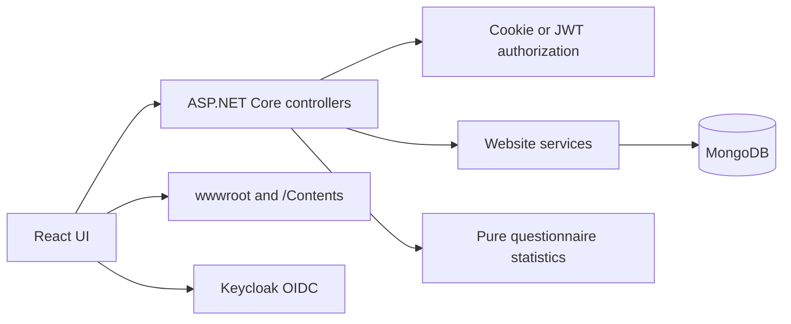

# Architecture

## Repository Layout

The repository contains one ASP.NET Core website/API, a React SPA with the
questionnaire module, a manual data-migration executable and isolated verification
projects. The root [DotNetLiguria.slnx](../DotNetLiguria.slnx) contains nine .NET 10
projects, grouped into Aspire, website and unit-test folders.

The [development launcher](aspire.md) starts the website, React SPA and MongoDB.
It retains external Keycloak; DataMigration never auto-starts. Historical SQL
Server/SQLite providers are confined to DataMigration, not application hosting.

| Location | Responsibility |
| --- | --- |
| [DotNetLiguriaCore](../src/dotnetliguriawebsite/DotNetLiguriaCore) | ASP.NET Core API, authentication, static files and SPA fallback |
| [DotNetLiguriaCore.Model](../src/dotnetliguriawebsite/DotNetLiguriaCore.Model) | Website domain types, API contracts and BSON compatibility |
| [CommonAuth](../src/dotnetliguriawebsite/CommonAuth) | Keycloak cookie/OIDC setup and token helpers |
| [CommonWeb](../src/dotnetliguriawebsite/CommonWeb) | Development environment-file loading |
| [DataMigration](../src/dotnetliguriawebsite/DataMigration) | Historical SQL/EF data export, MongoDB migration and legacy questionnaire import (`questionnaires` mode) |
| [dotnetliguriaspa](../src/dotnetliguriaspa) | React public/admin UI, Vite, TypeScript and Vitest |
| [DotNetLiguria.AppHost](../src/DotNetLiguria.AppHost) | Development orchestration for website, SPA and MongoDB |
| [DotNetLiguria.ServiceDefaults](../src/DotNetLiguria.ServiceDefaults) | Health checks and OpenTelemetry |
| [tests](../tests) | Two isolated .NET unit suites and frontend Vitest coverage |
| [.persisted](../.persisted) | Persistent roots: `contents` and `data` are included in admin snapshots; `backups` stores snapshots and privacy control files; `not-in-snapshot` stores Data Protection keys, logs, and newsletter operational state |

Build everything with `dotnet build DotNetLiguria.slnx -c Release` from the repository
root. Individual project paths still support independent builds and publishes;
solution folders do not change deployment boundaries. The shared gate builds the
root solution, then runs unit suites separately.

The retired questionnaire applications, Shared assemblies, unit/browser tests and
native image decoder are removed. The website's React designer, runner and results
backed by MongoDB are the only questionnaire application. See
[questionnaire.md](questionnaire.md) for the historical feature inventory, current
design and retained import procedure.

## Website Request Flow



Controllers are mapped before the `index.html` fallback. `wwwroot` serves the SPA;
the separate `Contents` directory is exposed at the case-sensitive `/Contents`
path. Keep API URLs and content URLs distinct, especially on Linux. Historical
workshop archives, images and downloads must not be deleted by frontend staging.

Website services use MongoDB collections configured through
`DotNetLiguriaDatabase`. The model assembly owns persisted BSON and public JSON
contracts. Obsolete workshop feedback endpoints and their services/DTOs are removed;
the old Feedback BSON shape and collection name remain only in DataMigration.

Questionnaires live in the `Questionnaire` and `QuestionnaireResponse` collections.
Admin endpoints (`api/Questionnaire`) require task-specific permission policies
for definitions, publication, statistics, responses and export; see
[authorization.md](authorization.md). Public endpoints (`api/PublicQuestionnaire`) are
anonymous and rate limited. Definition/response validation, visibility rules,
statistics and CSV export are pure services tested without MongoDB. The SPA serves
the runner at `/q/:questionnaireId` and `/feedback/:workshopId` and lazy-loads the
admin designer and results. Details are in [questionnaire.md](questionnaire.md).

Newsletter administration is separate from notification-consent campaign
preparation. The newsletter editor and reusable template editor persist private
versioned Markdown, event-data projections, inline images and prepared MIME
snapshots. The SMTP adapter submits one message to an operator-configured
distribution address; it does not enumerate website users or manage subscribers.
Production requires revision-bound testing, explicit approval and durable
duplicate/restore protection. See [newsletters.md](newsletters.md).

## Authentication And Configuration

The website retains cookie/OIDC and JWT bearer schemes. Keycloak uses authorization
code flow with PKCE; the server cookie remains Secure and SameSite=None. JWT claim
mapping and existing role/acr policies are preserved. An unsatisfied OTP requirement
records the requested `acr` for the existing challenge flow. Pushed authorization
requests are explicitly disabled to retain the pre-upgrade provider behavior.

The SPA retains AXA OIDC callbacks, silent callbacks and service-worker URLs. A
postinstall script copies the worker from the installed OIDC worker package while
preserving the trusted-domain configuration. Live provider login/logout and MFA
still require an integration check with the deployment's registered origins.

Server secrets belong in ASP.NET user secrets or deployment secret configuration,
never in checked-in examples, frontend variables, certificates or Docker layers.
Development environment-file loading runs only in DEBUG builds. Vite variables are
public build-time data: `VITE_API_BASE_URL` controls service requests and
`VITE_API_URL` optionally overrides the shared Axios base URL. Existing
`REACT_APP_API_BASE_URL` and `REACT_APP_API_URL` names remain supported as fallbacks.
Only those legacy public settings are exposed by the compatibility bridge.

## Persistence Compatibility

MongoDB 3 no longer supports the old unspecified GUID serializer defaults.
`BsonCompatibility.Configure()` runs before website or migration executable work.
Its idempotent registration writes CSharpLegacy UUID bytes, matching the old
BSON 2.19.1 behavior, and reads both legacy and Standard UUID subtypes. Local date
annotations and JSON names remain unchanged. Tests use synthetic BSON/JSON, not
production documents; migration approval is still required for real data.

DataMigration reads historical SQL entities and writes export/MongoDB data. Build
and publish checks never execute it. Do not run it, rotate credentials or apply
schema changes against real data without explicit approval. Its `questionnaires`
argument imports legacy Feedback and QuestionarioTest data as closed historical
questionnaires; it is a dry run unless `--apply` is passed and is idempotent
through deterministic ids and `SourceKey`.

Historical import reads the former `QuestionarioTest` schemas directly in
DataMigration and preserves their different rating scales. It does not reference
or run either retired application. QR codes are generated in the browser using
qrcode.react; no scanning/native image dependency, circuit telemetry or external
Application Insights package remains.

## Toolchains And Publishing

`global.json` pins SDK 10.0.401 with stable latest-patch roll-forward; `.node-version`
pins Node 24.21.0 (npm 11.19.0). The original timing baseline used Node 24.14.0;
frontend timings are rechecked on the updated pin. Use `npm ci` and the
checked-in package lock. React 19 and Vite replace CRA; the UI uses Tailwind CSS 4 and
React Aria Components. Vitest runs the frontend tests. Preserve the UI and routes during upgrades.

### Upgrade Inventory

Stable versions were resolved from official .NET release metadata, NuGet and npm
registries; manifests and the npm lock retain the exact selected versions.

| Area | Previous | Selected | Compatibility Decision |
| --- | --- | --- | --- |
| .NET targets | net6/net7/net9/netstandard | net10.0, SDK 10.0.401 | All nine remaining projects |
| Microsoft ASP.NET/EF | Mixed 3/6/7-era dependencies | 10.0.12 | Replace removed hosting APIs; preserve DB models |
| MongoDB Driver/Bson | 2.19.1 | 3.12.0 | Explicit legacy-compatible GUID serializer |
| Swagger | 6.5.0 | 10.3.0 | Retain existing API metadata integration |
| React and types | 18 | 19.3.0 | Upgrade runtime, DOM and types together |
| CRA/TypeScript | react-scripts 5 / TS 4.9 | Vite 8.3.4 / TS 6.0.3 | New HTML entry and public environment bridge |
| UI kit | MUI 5 / Data Grid | Tailwind CSS 4.3.3 / React Aria Components 1.22.1 | Redesign; MUI, Emotion and Data Grid removed |
| Test runners | Legacy Jest/browser-only .NET checks | Vitest 5.0.3 / xUnit.net v3 (`xunit.v3` 4.0.2) | Offline units; live integration checks remain opt-in |
| QR | Server-side decoding | qrcode.react 4.2.0 | Browser-side generation; native decoding removed |

```powershell
pwsh -File scripts/verify.ps1
pwsh -File scripts/verify-publish.ps1
```

The first command restores/builds all projects, clean-installs the frontend, checks
types/lint/build and runs counted units with deadlines.
The second publishes the website and DataMigration into `.artifacts/publish` without executing
them. It compares every Vite output file by hash, checks historical workshop
samples, and verifies executable entrypoints.

`npm run build` only produces `src/dotnetliguriaspa/dist`; it does not copy to source
`wwwroot`. Website `dotnet publish` overlays that built dist into the publish
artifact and replaces only matching SPA paths. Missing dist fails explicitly.
`PublishSpa=false` is an intentional API-only escape hatch, not the normal website
deployment. Use a fresh publish destination so obsolete generated assets cannot
accumulate across releases. Source historical content is never cleaned.

Build the Docker image from the repository root:

```powershell
docker build -f src/dotnetliguriawebsite/DotNetLiguriaCore/Dockerfile -t dotnetliguria .
```

The image builds the SPA with pinned Node, restores all referenced website projects,
and publishes with pinned .NET 10 SDK/runtime images. Public API build arguments
default to same-origin `/api`. The non-root runtime listens on HTTP 8080; provision
TLS and registered OIDC origins at the deployment boundary. The root dockerignore
excludes local environment files, certificates, private keys and generated output.
Do not place deployment secrets in image build arguments.

## Verification And Agent Guidance

See [test procedures](../tests/Tests.md) and
[timing budgets](../scripts/timing-budgets.json). Minimum discovery is 25 repository,
97 backend and 73 frontend tests. The existing warmed Windows timing ceilings are
unchanged. Timings include process startup
but exclude restore/build, browser and database work. Ceilings are three
times observed maxima, rounded up to five seconds; dropped discovery counts,
skips, failures and timeout overruns fail the gate.

`.editorconfig` and build code-style settings support private-field naming.
Roslyn tests are the executable backstop for `_camelCase`, including implicit,
static, readonly and constant private fields, and one handwritten type per file
(including nested types, interfaces, records, enums, structs and delegates).
Razor code blocks and DEBUG/Release branches are scanned. Generated exemptions
require an expected generated filename and an auto-generated banner.

Root/scoped AGENTS.md files guide ownership and safety. Codex reads AGENTS.md and
canonical skills under `.agents/skills`; Claude uses CLAUDE.md and forwarding
`.claude/skills`; Copilot uses `.github/copilot-instructions.md` and forwarding
`.github/skills`. Shared skills cover dependency modernization and fast verification.
Their paths/frontmatter are checked, but instructions do not enforce code rules by
themselves and live host skill-discovery has not been smoke-tested.

The CI workflow runs the shared gate and publish checks on Windows
and Linux, plus an Ubuntu container build. Configure repository branch protection
to require both Verify checks; YAML alone does not configure that policy.

Full Linux application builds/publishes, image execution and live OIDC/database
behavior require their platform/integration checks; Windows isolated tests do not
prove those paths. Historical compiler/lint warnings and the
large frontend bundle warning remain; they are not silently treated as clean checks.
The editor image scan reports nine high findings in the Node 24.21.0 Alpine builder
(no critical findings after replacing the older image). This is a build-only stage,
not the final .NET runtime image, but its findings still need authenticated Scout
triage before deployment. Scout inspection could not proceed without Docker login.
The npm package audit passed with zero findings; that does not clear image findings.
Npm 11.19 also warns about unapproved AXA informational lifecycle scripts; the root
postinstall worker-sync step runs successfully without granting them extra permissions.
