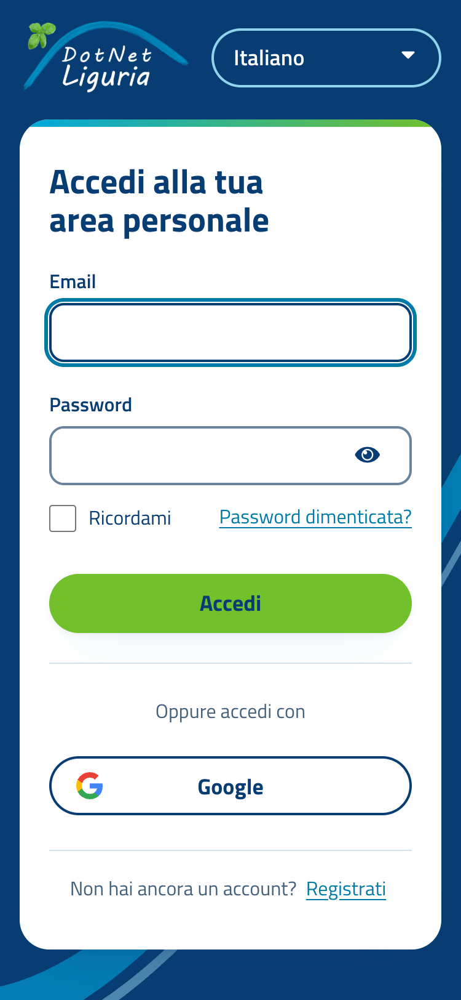
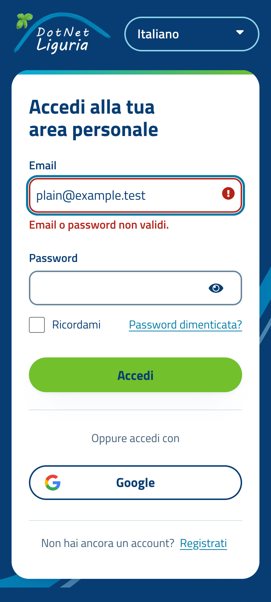
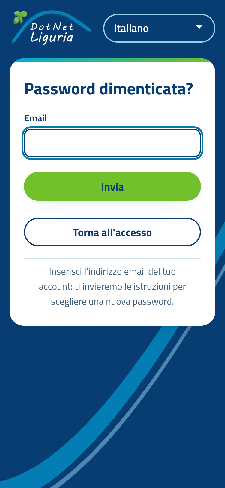
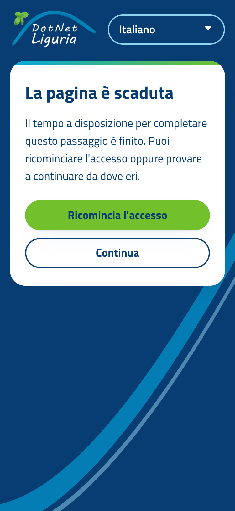

# Tema di login Keycloak "dotnetliguria"

Documento per Raffaele: cosa contiene il tema, come costruirlo, come installarlo sul Keycloak
di Vevy (`hello.vevy.com`, realm `DotNetLiguria`), come attivarlo, come tornare indietro.

Il tema cambia solo l'aspetto delle pagine di accesso (login, password dimenticata, registrazione,
aggiornamento password, OTP, uscita, errori) e alcuni testi. Non tocca utenti, client, flussi di
autenticazione, ruoli, email, console account. Il codice è in `keycloak/` (fuori da `src/`: non
entra nella soluzione .NET né nella build della SPA).

| Login desktop | Login telefono | Errore |
|---|---|---|
|  |  |  |

| Password dimenticata | Pagina scaduta |
|---|---|
|  |  |

## 1. Quale Keycloak gira in produzione

**Keycloak 26.6.3** (con lo stesso bundle dell'immagine ufficiale; non si distingue da una
eventuale 26.6.x successiva che non cambi la console account). Non c'è una pagina pubblica che
dichiari la versione: l'ho ricavata confrontando i file serviti da `hello.vevy.com` con le immagini
ufficiali `quay.io/keycloak/keycloak` (26.3.5, 26.6.0, 26.6.1, 26.6.2, 26.6.3, 26.7.0), con sole
richieste GET pubbliche (nessun accesso, nessun invio di moduli).

| Prova | Risultato |
|---|---|
| Console account, `/realms/DotNetLiguria/account`: il bundle JavaScript è `main-DN2Jgjz2.js` | Identico byte per byte (SHA-1 `ba3d9295…`) a quello dell'immagine **26.6.3**. Gli altri hanno nome diverso: 26.3.5 `LUzvbrIo`, 26.6.0 `vGkubYm_`, 26.6.1 `CkEH2Dpm`, 26.6.2 `CpWbGong`, 26.7.0 `DirfvvoG`. |
| `login/keycloak/css/login.css` | Identico a quello di 26.6.3 e 26.7.0 (SHA-1 `52947e20…`, 11 091 byte), diverso da 26.3.5 (10 845 byte). |
| Documento OIDC `.well-known/openid-configuration` | Contiene `client_id_metadata_document_supported`, algoritmi DPoP e grant `jwt-bearer`: funzioni recenti, coerenti con 26.6. |
| Console account | Tema `keycloak.v3` (PatternFly 5), con le opzioni `isOid4VciEnabled` e `updateEmailFeatureEnabled`. |
| Intestazioni HTTP | `Server: nginx/1.18.0 (Ubuntu)`: Keycloak sta dietro un reverse proxy nginx; `/` rimanda a `keycloak.ge.vevy.com/admin/`. |

**Tema di login attuale.** La pagina di accesso usa il tema classico **`keycloak`** (percorsi
`/resources/…/login/keycloak/…`, PatternFly 3 e 4, sfondo a poligoni). In Keycloak 26.6 il tema
predefinito è invece `keycloak.v2` (PatternFly 5): provando l'immagine 26.6.3 in locale, un realm
senza tema di login esplicito mostra `keycloak.v2`, mentre solo con `keycloak` scelto a mano
compare il classico. Quindi nel realm `DotNetLiguria` il tema `keycloak` è selezionato
esplicitamente (probabilmente da una versione più vecchia). Il classico non è più il tema
predefinito, compare tra le funzioni `LOGIN_V1` (spenta di default) e resta selezionabile, ma
non è una base su cui costruire: **il nuovo tema estende `keycloak.v2`**, quello che Keycloak
indica come predefinito per il login.

Altro che si legge dalle pagine pubbliche e che il tema rispetta: registrazione attiva (link
«Registrati»), email come nome utente, «Ricordami», identity provider Google (alias `google`),
**internazionalizzazione spenta** (`isInternationalizationEnabled: false`, quindi pagine sempre in
inglese), intestazione CSP personalizzata (`frame-src` verso `https://www.google.com`).

## 2. Cosa cambia il tema

- **Aspetto**: pagina blu navy (`#083d73`) con l'arco ciano del logo, scheda bianca arrotondata con
  un filo ciano-verde in alto, logo storico (variante a scritta bianca), Titillium Web incluso nel
  tema (nessuna richiesta a Google Fonts), pulsanti a pillola come sul sito. Azione principale verde
  del sito con testo navy; azioni secondarie a contorno navy; link ciano scuro `#007ba6`,
  sempre sottolineati. Il pulsante Google ha lo stesso stile a contorno (sfondo azzurrino al passaggio
  del mouse, così i colori del logo Google restano su fondo chiaro).
- **Testi in italiano** (`messages/messages_it.properties`): solo le stringhe che cambiano rispetto
  alla traduzione di Keycloak, ad esempio «Accedi alla tua area personale», «Non hai ancora un
  account?», «Email o password non validi.», «Esci», «Qualcosa non ha funzionato», «Torna al sito».
  In inglese (`messages_en.properties`) solo le chiavi nuove e i due link di ritorno, senza il carattere decorativo `«` che gli screen reader leggono ad alta voce.
- **Accessibilità (WCAG 2.2 AA)**: contrasti verificati (il più basso è 4,79:1, link su bianco);
  bordi dei campi 3,9:1; focus sempre visibile (anello 3 px); bersagli da 44 px; messaggi di errore
  annunciati agli screen reader (`role="alert"`/`status`, tipo scritto a parole, non solo colore),
  campo in errore collegato al suo messaggio (`aria-describedby`); la lingua della pagina è quella
  del realm; rispetta `prefers-reduced-motion` (l'arco non si anima) e non scorre in orizzontale
  nemmeno a 320 px.
- **Correzioni a difetti del tema Keycloak**: nella pagina di configurazione dell'app di
  autenticazione le due etichette puntavano a un id inesistente (i campi non avevano nome
  accessibile) e il testo alternativo del QR era fisso in inglese; il nome utente di sola lettura
  del secondo passo non aveva etichetta; la tooltip del pulsante «Riavvia accesso» usciva dalla
  scheda e faceva scorrere la pagina su telefono; la pagina «scaduta» aveva due link «clicca qui»
  indistinguibili; `info.ftl` ripeteva il titolo nel testo.
- **Modo scuro**: spento (`darkMode=false`): il marchio è una scheda bianca su navy, sempre uguale.
- **Non incluso**: nessun tema email, account o admin (si sceglie solo il tema di login).

### Struttura

```
keycloak/
  build-theme.sh              costruisce il JAR (bash + zip, niente rete)
  check-upstream.sh           prima di un aggiornamento di Keycloak: cosa è cambiato nei file copiati
  .gitignore                  dist/ e *.jar non si committano
  dev/compose.yaml            Keycloak locale (stessa versione di produzione) col tema montato
  dev/realm-dotnetliguria.json  realm di prova (client DotNetLiguriaSpa, Google finto, italiano)
  dotnetliguria-theme/
    META-INF/keycloak-themes.json
    theme/dotnetliguria/login/
      theme.properties        parent=keycloak.v2, stili, darkMode=false
      messages/               messages_it.properties, messages_en.properties
      resources/css/dotnetliguria.css, fonts/ (Titillium Web, licenza OFL), img/ (logo, favicon)
      template.ftl            cornice (copia modificata di keycloak.v2)
      field.ftl               campi (copia modificata di keycloak.v2)
      login-config-totp.ftl   app di autenticazione (copia modificata di keycloak.v2)
      info.ftl, error.ftl, logout-confirm.ftl, login-page-expired.ftl   (copie modificate del tema base)
```

Le pagine non elencate (login, registrazione, password dimenticata, OTP, …) sono quelle di
`keycloak.v2`, rivestite dal CSS. Ogni `.ftl` copiato porta in testa un commento con la versione di
origine e le modifiche, marcate `DNL`.

## 3. Costruire il JAR

```bash
keycloak/build-theme.sh
# → keycloak/dist/dotnetliguria-login-theme.jar   (140 KB circa)
```

Servono solo bash e `zip` (in alternativa un `jar` funzionante). Il nome del file è sempre lo
stesso apposta: copiare una nuova versione sopra la vecchia la sostituisce, e non possono convivere
due JAR che dichiarano lo stesso tema (Keycloak ne caricherebbe uno a caso). La versione
(`git describe`, o `THEME_VERSION=…`) finisce nel `MANIFEST.MF`. Lo script rifiuta di costruire un
albero incompleto. Il JAR non è nel repository.

## 4. Provarlo in locale

```bash
export KC_ADMIN_PASSWORD="$(openssl rand -hex 12)"      # a perdere, solo locale
docker compose -f keycloak/dev/compose.yaml up -d
```

Apri
`http://localhost:18080/realms/DotNetLiguria/protocol/openid-connect/auth?client_id=DotNetLiguriaSpa&response_type=code&scope=openid&redirect_uri=https%3A%2F%2Flocalhost%3A5443%2Fauthentication%2Fcallback`.
Console di amministrazione: `http://localhost:18080/admin/`, utente `admin` e la password esportata.
Il realm di prova (`dev/realm-dotnetliguria.json`) non contiene utenti né segreti: il provider
Google ha credenziali finte, quindi il pulsante si vede ma il giro su Google non si completa. Per
provare le pagine che richiedono un utente (aggiorna password, OTP) crealo dalla console. La cartella
del tema è montata così com'è e la cache è spenta: modifichi un file e ricarichi la pagina.
L'immagine è `quay.io/keycloak/keycloak:26.6.3`; con `KEYCLOAK_IMAGE=…` se ne prova un'altra.
Per fermare: `docker compose -f keycloak/dev/compose.yaml down`.

## 5. Installarlo in produzione (Keycloak di Vevy)

**Cosa sapere prima.** Installare un tema lo rende *disponibile* in tutto il server, ma ogni realm
sceglie il proprio: gli altri realm di Vevy non cambiano finché non lo selezionano. Il riavvio,
invece, interrompe per qualche decina di secondi gli accessi di **tutti** i realm di
quell'istanza: da concordare con Vevy, meglio in un'ora tranquilla. Il JAR non modifica dati.

### Opzione A: JAR in `providers/` (consigliata)

```bash
# sul server Keycloak (percorsi tipici, adatta a come è installato)
sudo cp dotnetliguria-login-theme.jar /opt/keycloak/providers/
sudo -u keycloak /opt/keycloak/bin/kc.sh build     # solo se Keycloak parte con "start --optimized" (produzione)
sudo systemctl restart keycloak
```

Se il servizio parte con `kc.sh start` (senza `--optimized`) il `build` avviene da solo
all'avvio, ma l'avvio è più lento. Il `build` deve usare le stesse opzioni di build del server in
esecuzione (database, `features`, …): conviene tenerle in `conf/keycloak.conf` anziché sulla riga di
comando. Verificato in locale con un'immagine `kc.sh build` + `start --optimized` (profilo `prod`).

### Opzione B: cartella `themes/` (senza `build`)

```bash
sudo cp -R keycloak/dotnetliguria-theme/theme/dotnetliguria /opt/keycloak/themes/
sudo systemctl restart keycloak
```

Un tema "a cartella" non richiede `kc.sh build` (verificato con `start --optimized`); serve il
riavvio. È comoda per una prova, ma il JAR è più semplice da aggiornare e da togliere.

### Container e Kubernetes

- **Nell'immagine** (come l'ho provato):
  ```dockerfile
  FROM quay.io/keycloak/keycloak:26.6.3 AS builder
  COPY dotnetliguria-login-theme.jar /opt/keycloak/providers/
  RUN /opt/keycloak/bin/kc.sh build
  FROM quay.io/keycloak/keycloak:26.6.3
  COPY --from=builder /opt/keycloak/ /opt/keycloak/
  ENTRYPOINT ["/opt/keycloak/bin/kc.sh"]
  ```
  Poi `start --optimized …` con le solite opzioni; l'aggiornamento del tema è un nuovo deploy.
- **Volume** (Kubernetes, Compose): montare la **cartella** del tema su `/opt/keycloak/themes/dotnetliguria`
  (opzione B, nessun `build`; ad esempio da una ConfigMap/immagine di appoggio con un `initContainer`).
  Montare il solo JAR su `providers/` funziona con `start` o `start-dev` (che ricostruiscono), non con
  un'immagine già `build`-ata.

### Il reverse proxy

nginx non richiede modifiche: le risorse del tema passano da `/resources/…`, come quelle del tema
attuale.

## 6. Attivarlo nel realm

1. **Annota il valore attuale**: console di amministrazione → realm `DotNetLiguria` →
   *Realm settings* → *Themes* → *Login theme* (oggi dovrebbe essere `keycloak`).
2. Dopo il riavvio, il menu *Login theme* elenca `dotnetliguria`. Selezionalo e salva.
   Per una prova senza toccare il realm: *Clients* → `DotNetLiguriaSpa` → *Settings* → *Login settings*
   → *Login theme*; vale solo per gli accessi di quel client (la console account, che usa un altro
   client, resta col tema vecchio).
3. **Lingua**: il tema ha testi italiani ma la lingua la decide il realm. Oggi
   l'internazionalizzazione è spenta e le pagine restano in inglese. In *Realm settings* →
   *Localization*: *Internationalization* **On**, *Supported locales* `Italiano` (aggiungi `English` se
   vuoi il selettore di lingua), *Default locale* `Italiano`. Se i locali supportati sono due, Keycloak
   sceglie la lingua del browser; se è solo `Italiano`, tutti vedono l'italiano. Attenzione: è
   un'impostazione del realm, vale anche per la console account e per le email (con le traduzioni
   italiane standard di Keycloak).

Il tema non cambia: «Registrati» resta visibile perché la registrazione è attiva nel realm; per
toglierla si agisce su *Realm settings* → *Login*, non sul tema.

## 7. Cache

Un server in produzione tiene in memoria temi e template e dice ai browser di conservare le risorse
statiche (oggi `Cache-Control: max-age=2592000`, 30 giorni). Non è un problema per gli
aggiornamenti: l'indirizzo delle risorse contiene un segmento (`/resources/<codice>/…`) che cambia a ogni
avvio del server, quindi dopo il riavvio i browser scaricano il CSS nuovo.

Per **sviluppare** su un Keycloak vero, spegni la cache (solo lì):

```
kc.sh start-dev --spi-theme--static-max-age=-1 --spi-theme--cache-themes=false --spi-theme--cache-templates=false
```

`start-dev` la tiene già spenta; il compose locale passa le tre opzioni comunque. In produzione non
spegnerle. Verificato: con `--spi-theme--static-max-age=120` un'immagine `start --optimized`
risponde `Cache-Control: max-age=120` sulle risorse del tema.

## 8. Tornare indietro

- **Subito**: *Realm settings* → *Themes* → *Login theme* → rimetti il valore annotato (`keycloak`)
  e salva. Nessun riavvio: le pagine tornano come prima.
- **Togliere il tema dal server**, dopo aver rimesso il tema precedente nel realm: cancella
  `/opt/keycloak/providers/dotnetliguria-login-theme.jar` (o la cartella `themes/dotnetliguria`),
  poi `kc.sh build` se serve e riavvio.
- Se un aggiornamento di Keycloak rompe il tema (pagina di accesso con errore 500): scegli
  `keycloak.v2` (o `keycloak`) come tema di login del realm. La console di amministrazione usa il
  realm `master`, quindi resta raggiungibile.

## 9. Lista di prova dopo l'installazione

Con un utente di prova (non il tuo amministratore), da telefono e da computer:

- [ ] La pagina di accesso mostra logo, arco, scheda bianca, pulsante verde «Accedi», pulsante Google.
- [ ] Accesso con email e password corrette: arrivi nella SPA (area personale).
- [ ] Password sbagliata: messaggio rosso sotto il campo email, campo password vuoto, nessun errore 500.
- [ ] «Password dimenticata?»: la pagina si apre; con un indirizzo esistente arriva l'email.
- [ ] «Registrati» (se attiva) e ritorno con «Torna all'accesso».
- [ ] Accesso con Google (client Google reale): torna alla SPA.
- [ ] Utente con OTP (o richiesta `acr_values` `mfa`/`hwk`): pagina del codice monouso corretta.
- [ ] Password da aggiornare (azione obbligatoria): pagina «Aggiorna password» e uscita.
- [ ] «Esci» dalla SPA: pagina di conferma e ritorno al sito.
- [ ] Tastiera: Tab attraversa logo, lingua (se presente), campi, link e pulsanti con anello visibile.
- [ ] Zoom 200 % e larghezza 320 px: nessuno scorrimento orizzontale.
- [ ] Lingua: pagine in italiano (vedi punto 6.3).
- [ ] La console account (`/realms/DotNetLiguria/account`) funziona come prima.

## 10. Che cosa è stato verificato, e che cosa no

Verificato su **Keycloak 26.6.3** (come in produzione) con un realm di prova e Chrome:
accesso, accesso con errore (campi vuoti, credenziali errate), password dimenticata (invio),
registrazione (con errori), aggiornamento password (con errore), OTP (codice errato incluso),
configurazione dell'app di autenticazione, conferma di uscita, uscita avvenuta, pagina di errore,
pagina scaduta; a 1280, 375 e 320 px, italiano e inglese. `axe-core` 4.14: nessuna violazione
(regole WCAG 2.0/2.1/2.2 A e AA e buone pratiche) in nessuna delle 36 schermate; resta qualche
esito "da rivedere" dovuto ad `aria-invalid=""` vuoto nei campi della registrazione, che è del tema
Keycloak. Un controllo a parte sui contrasti del testo non trova nulla sotto 4,5:1 (3:1 per il
testo grande). Il JAR è stato provato in `start-dev` e in `start --optimized` (profilo `prod`).

**Non verificato**: pagine con WebAuthn e passkey (`webauthn-*.ftl`, `login-passkeys-*`): ereditano
gli stili ma non ho un'autenticazione hardware con cui provarle; selezione dell'autenticazione
(«Prova in un altro modo»); verifica email; consenso OAuth; lettura con uno screen reader reale
(solo controlli automatici e struttura); il flusso con `acr_values` `mfa`/`hwk` del realm vero
(usa un flusso personalizzato che non ho visto).

## 11. Aggiornare Keycloak

Il tema contiene copie modificate di alcuni template di Keycloak. Una copia **fissa** il
comportamento della versione da cui nasce: se Keycloak cambia o toglie una proprietà o un blocco
che la copia usa, la copia non lo sa.

- **Versione minima: 26.6.** I template sono copiati da 26.6.3. Provato su un'immagine **26.3.5**: la
  pagina di accesso risponde 500 (`properties.kcFormPasswordVisibilityIconShow` non esiste in quella
  versione di `keycloak.v2`). Le versioni 26.4 e 26.5 non sono state provate.
- **26.7.0**: provata, tutte le pagine funzionano, zero violazioni `axe-core`. Rispetto a 26.6.3,
  dei file che il tema copia o usa, cambiano `template.ftl` (nuovo meccanismo `theme-resources.ftl`
  per stili e icone, e il link «cambia organizzazione»), `theme.properties` (classi della selezione
  dell'autenticazione e dimensione dell'icona WebAuthn) e `styles.css` (griglia dell'intestazione,
  spaziatura di WebAuthn). La copia di `template.ftl` continua a funzionare perché la 26.7 conserva
  il vecchio percorso (`properties.styles`), ma non mostra il link delle organizzazioni (il realm non
  le usa). Gli altri file copiati sono identici.
- **Prima di ogni aggiornamento** (serve Docker):
  ```bash
  keycloak/check-upstream.sh <nuova-versione>          # confronta con 26.6.3, la base del tema
  keycloak/check-upstream.sh 26.8.0 26.7.0             # oppure con un'altra versione di partenza
  ```
  Mostra le differenze dei soli file copiati (`template.ftl`, `field.ftl`, `login-config-totp.ftl`,
  `info.ftl`, `error.ftl`, `logout-confirm.ftl`, `login-page-expired.ftl`) più `theme.properties` e
  `styles.css` di `keycloak.v2` (nomi di classi e layout su cui poggia il CSS). Se qualcosa è
  cambiato: porta la modifica nella copia, ricostruisci, rifai la lista di prova del punto 9 su un
  Keycloak locale (`KEYCLOAK_IMAGE=quay.io/keycloak/keycloak:<nuova-versione>`).
- Dopo l'aggiornamento in produzione apri subito la pagina di accesso; se dà errore 500 vedi il punto 8.
- Se un giorno `keycloak.v2` sparisse, `check-upstream.sh` si ferma con un avviso: sarebbe da
  rifare il tema sul nuovo tema di base.

## 12. Da decidere

1. **Lingua**: attivare l'internazionalizzazione del realm con italiano predefinito (punto 6.3).
   Senza, il tema funziona ma le pagine restano in inglese. Vale anche per console account ed email.
2. **Livello di attivazione**: tema di realm (tutte le pagine di accesso del realm) o solo sul client
   `DotNetLiguriaSpa` per una prima prova.
3. **Registrazione**: il link «Registrati» resta come nel realm; se la community non vuole
   iscrizioni aperte si disattiva nel realm, non nel tema.
4. **Email e console account**: il tema non le tocca. Se interessa uno stile coerente servono due
   temi in più (email e account), da pianificare a parte.
5. **Messaggio di credenziali errate**: in italiano dice «Email o password non validi.»
   (il realm usa l'email come nome utente). Se un giorno si accedesse con un nome utente, va
   rivisto `invalidUserMessage` in `messages_it.properties`.

## 13. Licenze

- Titillium Web: SIL Open Font License 1.1 (testo in `resources/fonts/OFL.txt`), file woff2 di
  `@fontsource/titillium-web` 5.3.0.
- I template copiati derivano dal tema di Keycloak (Apache License 2.0).
- Il logo è quello storico di dotnetliguria.net, lo stesso del sito (PNG, variante a scritta bianca).
