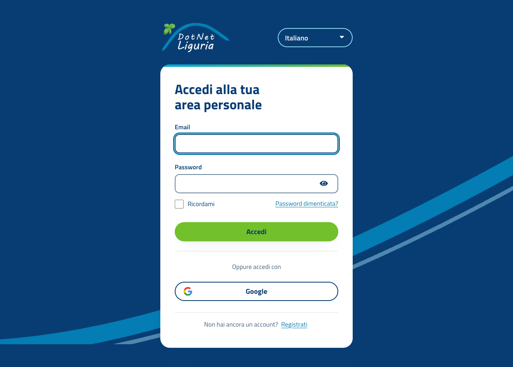

# DotNetLiguria Keycloak login theme

The `dotnetliguria` login theme styles the `DotNetLiguria` realm login pages to
match the website. The production Keycloak instance at `hello.vevy.com` runs
Keycloak **26.6.3**; the theme extends `keycloak.v2` and requires Keycloak 26.6
or later.



## Overview

Build and test the theme on a development machine. The only file that needs to
be transferred to the production deployment is:

```text
keycloak/dist/dotnetliguria-login-theme.jar
```

Production Keycloak runs in a container, so do not copy the JAR to
`/opt/keycloak/providers` on the host and do not install it by modifying a
running container. Container filesystems are replaced when containers are
recreated. Add the JAR to the Keycloak container image and deploy that image.
The person or team that owns the production deployment must perform the image
build and rollout.

## 1. Build on the development machine

From the repository root, run the build script in Bash (for example, Git Bash,
WSL, Linux, or macOS). It needs `zip` or a working JDK `jar` command; no network,
Maven, or Node.js is required.

```bash
bash keycloak/build-theme.sh
```

The script creates `keycloak/dist/dotnetliguria-login-theme.jar` and prints
its SHA-256 checksum. This JAR contains the theme manifest and login theme
files. Do not transfer the source folder or the whole repository for
installation.

## 2. Test locally before handing it off

The repository includes a disposable Keycloak setup. It mounts the theme source
folder directly, so theme edits can be tested without building a JAR or
touching production.

In Bash, set a throwaway local-only admin password and start the local instance:

```bash
export KC_ADMIN_PASSWORD="$(openssl rand -hex 12)"
docker compose -f keycloak/dev/compose.yaml up -d
```

Open the local login page:

```text
http://localhost:18080/realms/DotNetLiguria/protocol/openid-connect/auth?client_id=DotNetLiguriaSpa&response_type=code&scope=openid&redirect_uri=https%3A%2F%2Flocalhost%3A5443%2Fauthentication%2Fcallback
```

When finished, stop the disposable instance:

```bash
docker compose -f keycloak/dev/compose.yaml down
```

The local Compose setup is only for theme testing; it does not deploy or modify
the production Keycloak instance or realm.

## 3. Transfer the built JAR

Transfer **only**
`keycloak/dist/dotnetliguria-login-theme.jar` to the production deployment
owner using the team's approved artifact store or secure file-transfer method.
For example, if the deployment owner provides an SSH destination and image
build-context directory:

```bash
scp keycloak/dist/dotnetliguria-login-theme.jar \
  <deployment-user>@<deployment-host>:<build-context>/dotnetliguria-login-theme.jar
```

Compare the SHA-256 checksum printed by the build script with the checksum of
the received file before building the production image:

```bash
sha256sum dotnetliguria-login-theme.jar
```

On macOS, use `shasum -a 256 dotnetliguria-login-theme.jar` if `sha256sum` is
not available. Do not send Keycloak secrets, realm exports, or credentials with
the theme artifact.

## 4. Install it in the production container image

The production deployment owner should add the JAR to the Keycloak image build
context and add the following to the **existing production Keycloak Dockerfile**:

```dockerfile
FROM quay.io/keycloak/keycloak:26.6.3
COPY --chown=keycloak:keycloak dotnetliguria-login-theme.jar /opt/keycloak/providers/
RUN /opt/keycloak/bin/kc.sh build
```

If production already uses a custom Keycloak image, keep its existing base
image, configuration, and provider files; add the `COPY` and `RUN` steps to
that Dockerfile rather than replacing it with this example. Use the same
Keycloak version as production. From the directory containing the Dockerfile
and the transferred JAR, build and publish the image (replace the placeholders
with the registry, image name, and unique release tag used by the deployment):

```bash
docker build -t <registry>/<keycloak-image>:<tag> .
docker push <registry>/<keycloak-image>:<tag>
```

Update the production container deployment to use that image and let its normal
rollout replace the running container(s). The exact service or deployment
command depends on the production orchestrator; use its existing release
process. Keep the existing startup command and runtime configuration
(including any `start --optimized` setting).

The JAR must be present in `/opt/keycloak/providers/` **before** running
`kc.sh build`. This makes the provider part of the built image, so every
replacement container has the theme. Do not copy it into a running container:
that change is temporary and will be lost on container replacement.

Coordinate the rollout with the production operator. Replacing the Keycloak
container restarts Keycloak and can briefly interrupt login for every realm on
that instance. Downtime depends on the deployment's replica and rollout
configuration.

## 5. Activate and verify the theme

After the new image is running:

1. In the Keycloak Admin Console, note the current theme at **Realm settings**
   → **Themes** → **Login theme**.
2. First enable `dotnetliguria` only for the website client:
   **Clients** → `DotNetLiguriaSpa` → **Login settings** → **Login theme**.
   Save and test a real login flow. If the client-specific setting is
   unavailable or you intend to change the whole realm, use the realm setting
   in the next step instead.
3. To enable it for every client in the realm, choose `dotnetliguria` at
   **Realm settings** → **Themes** → **Login theme** and save.
4. Optionally set Italian as the default locale at **Realm settings** →
   **Localization**. Enabling internationalization and changing the default
   locale affects the realm's other localized pages and messages too.

## Rollback

If the theme needs to be disabled, set the affected client or realm's login
theme back to the value recorded before activation (currently `keycloak`) and
save. If the image itself must also be rolled back, restore the previous theme
setting first, then deploy the previous Keycloak image using the normal
deployment process.

## Notes

- The theme includes login pages only; email and account-console themes are
  unchanged.
- The local realm enables Italian and English and defaults to Italian. These
  are local test settings, not instructions to change production localization.
- After a Keycloak upgrade, review upstream template changes with
  `keycloak/check-upstream.sh <new-version>` and follow its output before
  shipping the theme against the new version.
